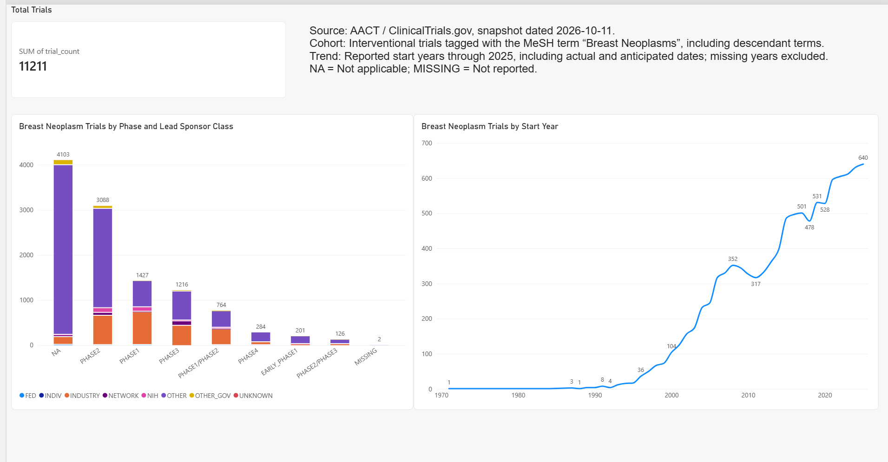
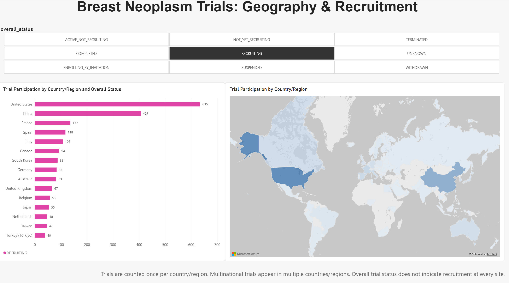
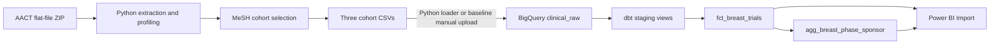

# Breast Neoplasm Clinical Trial Analytics

A snapshot-based data engineering learning project using **Python, BigQuery, dbt, and Power BI**. It builds a defined cohort of breast-neoplasm-related interventional trials from AACT and describes their registered phases, lead sponsor classes, and reported start years.

**Initial baseline:** local extraction and cohort preparation, manual BigQuery loading, tested dbt transformations, and a Power BI Desktop report. A Python loader now supports replacing the same three raw tables. Daily API ingestion and scheduling are not implemented.

## Dashboard



Location extension, filtered to trials whose overall status is `RECRUITING`:



Open [the Power BI report](Dashboard/breast_trials_dashboard.pbix) in Power BI Desktop. It contains imported snapshot data; refreshing requires access to the configured BigQuery project, or reconfiguring the connection to your own project.

- **Total Trials:** 11,211 trials in the complete selected cohort.
- **Phase and Lead Sponsor Class:** trial counts for each phase, split by the class of the lead sponsor.
- **Start Year:** distinct trial counts by reported start year through 2025. Missing years, 2026, and future years are excluded from this chart only; the total card includes the full cohort.

## Questions

1. How many trials meet the cohort definition?
2. How are these trials distributed across registered phases and lead sponsor classes?
3. How are their reported start years distributed?

These are descriptive registry analyses, not estimates of treatment efficacy or trial success. Start year is not registration year, and this trend is not a daily update-activity chart.

## Data and cohort definition

Source: [AACT](https://aact.ctti-clinicaltrials.org/), a relational representation of [ClinicalTrials.gov](https://clinicaltrials.gov/) registry data. The baseline snapshot used for this project is dated **2026-10-11**.

The cohort contains trials that:

- Have the exact MeSH label `Breast Neoplasms` in `browse_conditions.txt`, with `mesh_type` of `mesh-list` or `mesh-ancestor` (including ancestor assignments for narrower terms).
- Have `study_type = INTERVENTIONAL` in `studies.txt`.

No restriction is applied to status, phase, sex, start date, or intervention purpose. This is an operational label-based breast-neoplasm cohort, not a clinically adjudicated malignant breast-cancer treatment cohort. The child exports retain all sponsors and all condition labels for selected trials.

Baseline counts:

- Full `studies.txt`: **606,594** trials.
- Full `sponsors.txt`: **966,593** relationships.
- Full `browse_conditions.txt`: **4,395,602** labels.
- Matching trials before the study-type filter: **14,340**.
- Selected exports: **11,211** study rows, **18,746** sponsor rows, **135,504** condition rows.

Counts may change when using another snapshot. The cohort script creates a fresh summary for each run; [the baseline summary](docs/baseline_cohort_summary.json) records the initial result.

## Data flow



`studies` has one row per trial; `sponsors` and condition labels have multiple rows per trial. The mart joins only the lead sponsor, after checking that each selected trial has exactly one. It does not join every sponsor and condition row into a flat trial table, which would multiply records.

dbt models:

- `stg_breast_studies`: trims fields and safely converts dates and enrollment values; one row per trial.
- `stg_breast_sponsors`: standardizes sponsor relationships and categories.
- `fct_breast_trials`: one row per trial, with its lead sponsor and derived start year.
- `agg_breast_phase_sponsor`: one row per phase and lead sponsor class, with `trial_count`.

`breast_conditions` is loaded as a raw source for cohort traceability and later analysis; this initial dbt mart does not transform it.

## Reproduce the initial version

The commands below are for **Windows Command Prompt / Anaconda Prompt**, run from the repository root. The original environment used Python 3.13.9. Python extraction scripts use only the standard library.

### 1. Create the project environment

```bat
python -m venv .venv
.venv\Scripts\python.exe -m pip install -r requirements.txt
.venv\Scripts\python.exe -m pip check
```

### 2. Download and prepare data

Download an AACT **Flat Text Files** snapshot ZIP from the AACT snapshots page. Raw files and processed CSVs are intentionally excluded from Git.

```bat
.venv\Scripts\python.exe src\extract_aact.py --zip "C:\path\to\aact_snapshot.zip"
.venv\Scripts\python.exe src\profile_aact.py
.venv\Scripts\python.exe src\build_breast_cohort.py
```

Extraction writes the three required tables to `data/raw/aact_snapshot/`. Profiling writes `data/processed/raw_profile.json`. Cohort exports and `cohort_summary.json` are written to `data/processed/breast_cohort/`.

### 3. Create BigQuery datasets and upload CSVs

Use your own GCP project. Create `clinical_raw` and `clinical_analytics` in the **same location** (the baseline uses the EU multi-region).

For each CSV in `data/processed/breast_cohort/`, create a table in `clinical_raw`:

- `breast_studies.csv` → `breast_studies`, schema: `config/studies_schema.json`.
- `breast_sponsors.csv` → `breast_sponsors`, schema: `config/sponsors_schema.json`.
- `breast_conditions.csv` → `breast_conditions`, schema: `config/conditions_schema.json`.

Select **CSV**, a comma delimiter, and **skip 1 header row**. Apply the provided schema rather than automatic type inference: raw columns are strings, with typed conversion handled by dbt. If the console does not show CSV options, ensure you are loading a CSV file rather than creating an empty table. Replace existing tables when reloading the same snapshot; do not append it again.

### 4. Configure authentication and dbt

Install the Google Cloud CLI, then authenticate for local application access:

```bat
gcloud auth application-default login
gcloud auth application-default set-quota-project YOUR_GCP_PROJECT_ID
copy config\profiles.example.yml config\profiles.yml
```

Edit `config/profiles.yml`: replace `YOUR_GCP_PROJECT_ID`, and use the location of your datasets. This local profile is ignored by Git. In `dbt/models/sources.yml`, replace the baseline `database: clinical-trials-learning` with your project ID too. Your account needs permission to query the raw tables, create jobs, and create views/tables in the analytics dataset.

```bat
.venv\Scripts\dbt.exe debug --project-dir dbt --profiles-dir config
.venv\Scripts\dbt.exe build --project-dir dbt --profiles-dir config --exclude tag:locations tag:api_updates
```

### Automated raw-table loading

After the authentication step above, replace manual CSV uploads with:

```bat
.venv\Scripts\python.exe src\load_bigquery.py --project YOUR_GCP_PROJECT_ID --snapshot-date 2026-10-11 --dry-run
.venv\Scripts\python.exe src\load_bigquery.py --project YOUR_GCP_PROJECT_ID --snapshot-date 2026-10-11
```

The first command validates local files only; it does not authenticate or contact Google. The second uses Application Default Credentials and replaces the three `clinical_raw` tables with `WRITE_TRUNCATE`, so rerunning a snapshot does not append duplicates. The dataset must already exist; use `--dataset` and `--location` to override `clinical_raw` and `EU`.

Before any cloud writes, all three CSVs must match their schemas (including column order), the generated summary counts, the interventional cohort, and trial/sponsor relationships. The loader permits quoted newlines, skips one header record, and rejects malformed rows rather than silently dropping them. It verifies each loaded table's row count.

Each invocation saves a JSON report in `data/processed/load_reports/`, including the user-supplied snapshot date, SHA-256 file hashes, expected/loaded row counts, job IDs, and status. The snapshot date is a supplied provenance label, not inferred or independently verified from the archive. Reports are local artifacts ignored by Git.

**The three replacements are not a single transaction.** A failure after the first table may leave a mixed set of raw tables. Stop downstream processing, inspect the report and BigQuery jobs, and rerun all three successfully before `dbt build`. Do not run two loaders concurrently. After a timeout, a submitted cloud job may still be running; check its ID before retrying. Per-table replacement is atomic on successful load completion ([BigQuery CSV loading documentation](https://docs.cloud.google.com/bigquery/docs/loading-data-cloud-storage-csv)).

After a successful load, run the dbt build in step 4 and refresh Power BI. Validate repeatability by loading the same snapshot again: row counts should remain unchanged and all dbt tests should pass.

Local loader checks:

```bat
.venv\Scripts\python.exe -m unittest discover -s tests -v
```

### Run the batch with one command

After configuring the project and authentication above:

```bat
.venv\Scripts\python.exe src\run_batch.py --project YOUR_GCP_PROJECT_ID --snapshot-date 2026-10-11
```

This runs profiling, cohort selection, BigQuery replacement, and `dbt build` sequentially using the same Python environment. Project IDs in the CLI, dbt profile, and source configuration must match. This initial runner targets the existing EU datasets and `clinical_raw` source. It does not download snapshots, create cloud resources, or refresh Power BI.

If the raw text files have not been extracted, add `--zip "C:\path\to\aact_snapshot.zip"`. Without `--zip`, the runner reuses the extracted text files, so ensure the supplied snapshot date describes those files. `--validate-only` rebuilds local cohort outputs and validates them, but does not load BigQuery or run dbt.

Each step has a separate log under `logs/batch/<run-id>/`, with a `report.json` recording commands, timestamps, exit codes, and overall status. A nonzero exit code stops the pipeline before downstream steps start. BigQuery load details remain in the loader's separate report. This prevents dbt from running after an unsuccessful load; it is not a rollback or a cross-table transaction. Run only one batch/loader at a time.

The command is manually triggered. Scheduling is a subsequent improvement.

### Optional location data

Use `facilities.txt` from the **same AACT snapshot** used for the trial cohort. It is streamed directly from the ZIP; extracting the entire archive is unnecessary.

```bat
.venv\Scripts\python.exe src\build_breast_locations.py --zip "C:\path\to\aact_snapshot.zip"
.venv\Scripts\python.exe src\load_bigquery.py --project YOUR_GCP_PROJECT_ID --snapshot-date 2026-10-11 --include-locations
.venv\Scripts\dbt.exe build --project-dir dbt --profiles-dir config --exclude tag:api_updates
```

The first command creates `breast_locations.csv` and `locations_summary.json` alongside the existing cohort. The loader's opt-in `--include-locations` validates and replaces **four** raw tables, including `clinical_raw.breast_locations`, using `config/locations_schema.json`. Default loading still replaces only the original three. Locations are tied to the study CSV and location CSV by SHA-256 hashes; regenerate them if the cohort changes. A snapshot date is still supplied by the user, not proven by these hashes.

New dbt models:

- `stg_breast_locations`: one **facility record** per row; facility IDs are not globally unique hospital identifiers. Trial IDs may appear many times. Country names are trimmed but not standardized to ISO codes in this iteration; coordinates are safely cast, not yet independently validated.
- `agg_breast_country_status`: unique trial-country relationships counted by country, phase, **overall trial status**, and lead sponsor class. Same-country sites do not multiply trial counts. Multinational trials contribute to multiple countries, so summing countries does not equal the global unique trial count.

Missing country is shown as `MISSING`. Trials with no facility records are absent from country statistics but remain in the overall cohort; coverage is recorded in `locations_summary.json`. A trial's overall recruitment status does not establish whether every facility is actively recruiting; facility status is stored separately. Do not present country participation as national ownership or registry completeness.

The location extension adds 2 models and 7 dbt tests (31 tests including the initial 24). After loading all four sources, `dbt build` can include all models. Until then, exclude `tag:locations`. The original runner automatically excludes those models/tests unless `--with-locations` is supplied.

To rebuild everything including locations with one command:

```bat
.venv\Scripts\python.exe src\run_batch.py --project YOUR_GCP_PROJECT_ID --snapshot-date 2026-10-11 --zip "C:\path\to\aact_snapshot.zip" --with-locations
```

This rebuilds the base cohort and its locations from the same ZIP, then loads four tables and runs all dbt models/tests. As with the original loader, these four replacements are not a single transaction.

### Docker in GitHub Codespaces

Docker support is prepared for validation in Codespaces; the image must be built and tested there before treating container execution as verified. No local Windows Docker installation is required. This does not schedule execution or refresh Power BI.

In the Codespaces **Linux terminal**, at the repository root:

```bash
docker --version
docker info --format '{{.OSType}}'
docker build -t clinical-batch:v1 .
docker run --rm clinical-batch:v1 -m unittest discover -s tests -v
```

The image installs pinned Python package versions and contains the scripts, models, schemas, and tests. Raw data, dashboards, dbt outputs, and local Google credentials are excluded from the build context. The Python base image pins the minor version, not the patch/digest; further locking can be added after the image has been validated.

For a first data check, transfer the four cohort CSVs plus `cohort_summary.json` and `locations_summary.json` to the same paths under `data/processed/breast_cohort/` in Codespaces. These files remain Git-ignored. If transferring a ZIP package containing the `breast_cohort/` directory, upload it to `data/processed/`, then extract it there using Python (which should be available in the standard Codespaces environment):

```bash
mkdir -p data/processed
python -m zipfile -e data/processed/codespaces_cohort.zip data/processed
docker run --rm \
  --mount type=bind,source="$(pwd)/data",target=/app/data \
  clinical-batch:v1 src/load_bigquery.py \
  --project clinical-trials-learning --snapshot-date 2026-10-11 \
  --include-locations --dry-run
```

This only validates CSVs and writes a local report; it requires no Google authentication. The location summary's content hashes remain valid when files are moved to Linux.

For full cloud execution, configure a local ignored dbt profile and Application Default Credentials in Codespaces, then mount the profile and credentials at runtime (read-only), together with data and writable logs. Do not copy credentials into the image. Full `run_batch.py --with-locations` additionally needs the original AACT ZIP; processed CSVs alone are sufficient only for the loader and subsequent dbt execution. Authentication/mount instructions will be validated after the basic container works.

Codespaces is a development environment: when it stops, local Docker services and schedules stop too.

### Kestra snapshot workflow

`orchestration/flows/clinical_snapshot.yml` contains a manually triggered, two-task workflow: load four prepared raw tables, then run dbt transformations/tests. It does not yet download or rebuild the cohort, ingest API updates, refresh Power BI, or run on a schedule. The snapshot date must describe the files, not today's date. The flow limits its own concurrent executions to one; avoid starting a separate manual loader while it runs.

Docker task runners require the Kestra server configuration in `orchestration/kestra-config.yml` to enable bind mounts. This is a server setting, not a field to paste into the Flow YAML. The local development server needs Docker socket access and a restart/recreation to apply the config; retain its `clinical_kestra_storage` and `clinical_kestra_db` named volumes so the saved flows and history persist. Keep the Codespaces port private.

Before executing, create `logs/dbt` and `data/dbt_target` on the Docker host. Supply the absolute repository path (`pwd`) as `workspace_dir`, and the absolute ADC JSON **file path** as `credential_file`. Neither credentials nor their contents belong in the flow or Git. Ensure the ignored dbt profile, model source, and project input all point to the same project. The task containers use code/models baked into `clinical-batch:v1`; rebuild that image after changing them.

The loader and dbt output are visible in Kestra execution logs. Loader reports are persisted under the mounted `data/processed/load_reports/`; dbt logs and target artifacts are mounted separately. A failed load prevents the dbt task from starting. The workflow does not roll back tables; check cloud job status before retrying after an interrupted load. The two-task flow was successfully executed in Codespaces against the baseline project.

For a controlled scheduling test, append `orchestration/schedule-test.example.yml` to the Flow at root level, replace its two path placeholders, and set `disabled: false`. It fires at five-minute clock boundaries in Europe/Stockholm and disables itself after success/failure/warning/killing. This tests scheduling against the existing snapshot, not daily data freshness. Confirm a trigger-origin execution in Kestra and keep the test schedule disabled afterwards. Codespaces/Kestra must remain running; the trigger is not a durable always-on production schedule.

### ClinicalTrials.gov API capture (first incremental step)

`src/fetch_trial_updates.py` fetches current full study JSON from the official public API, filters by last update posting date, follows every page token, and writes immutable run directories. It needs no Google credentials and does not modify BigQuery. It retains all API responses, but exports only IDs in the existing snapshot cohort; it does not admit newly registered trials or infer cohort membership from text searches.

After pulling the latest code and rebuilding the image in Codespaces:

```bash
docker run --rm \
  --mount type=bind,source="$(pwd)/data",target=/app/data \
  clinical-batch:v1 src/fetch_trial_updates.py \
  --start-date 2026-10-13
```

Optional `--end-date` supports date ranges (both bounds inclusive). Each run is saved in `data/raw/ctgov_updates/<start>_<end>/<run-id>/`: full `page_*.json`, per-page request metadata, a manifest, and a completed `cohort_updates.jsonl`. A failed/partial run keeps raw evidence and a failed manifest, but never publishes its matched output. HTTP transient errors have bounded retries; mismatched counts or repeated tokens fail rather than quietly accepting incomplete results. Zero updates can be a valid completed run.

The API exposes current/latest records, not every historical version. A historical date filter cannot recover a record's old state if it has since been updated again. We will collect observation history going forward; this capture alone is not a complete change log or a latest-trial warehouse update. Reruns retain separate raw captures; warehouse deduplication will be added before loading them.

### API observations and baseline comparison

`src/load_api_observations.py --run-dir <complete-capture-directory> --project <project>` loads matched records into `clinical_raw.api_trial_observations`. Add `--dry-run` for local validation only. The loader checks capture completion, cohort hash, output checksum (when present), field/date integrity, and row counts. Legacy captures without output checksums are explicitly noted. Existing snapshot raw tables and Power BI baseline models are not overwritten.

Each observation key combines trial ID, update posting date, and canonical full-payload hash. Identical JSON content reloaded from the same or another capture does not add a row; later matching captures advance `last_seen_at`, retaining the initial capture time as `observed_at`. These times are capture completion times, not source status-change dates or per-record event times. `source_run_id` identifies the first inserted capture. Different captured payloads on the same posting date remain distinct observations.

Rows are loaded into a temporary BigQuery table, then inserted/updated through `MERGE`; staging tables expire after 24 hours and are deleted after success. Failed jobs keep staging for diagnosis. The destination is date-partitioned and clustered on trial ID. Execute observation loaders sequentially: BigQuery does not enforce unique keys, and concurrent independent loaders are not supported. Cloud job IDs and results are saved under `data/processed/api_load_reports/`. After a timeout, inspect reported jobs before retrying.

After the initial observation table exists, run:

```bash
docker run --rm --entrypoint dbt \
  --mount type=bind,source="$(pwd)/config/profiles.yml",target=/app/config/profiles.yml,readonly \
  --mount type=bind,source="$HOME/.config/gcloud/application_default_credentials.json",target=/root/.config/gcloud/application_default_credentials.json,readonly \
  --mount type=bind,source="$(pwd)/logs/dbt",target=/app/dbt/logs \
  --mount type=bind,source="$(pwd)/data/dbt_target",target=/app/dbt/target \
  clinical-batch:v1 build --project-dir /app/dbt --profiles-dir /app/config \
  --select +mart_trial_status_comparison
```

New models: `stg_api_trial_observations` and `mart_trial_status_comparison` (tagged `api_updates`, with 7 new tests). The comparison picks the latest captured record per trial and compares its status to the currently loaded AACT baseline, without reconstructing historical transitions. The difference flag is null for older API records or incomparable baseline fields. Future monthly snapshot replacement changes this baseline; immutable historical AACT baselines are not implemented yet.

The snapshot runner and updated `clinical_snapshot` flow exclude `tag:api_updates` so they can still operate before the API table exists. Update an already-imported Kestra flow's `dbt_build` command accordingly. After the source exists, full `dbt build` can include both snapshot and API models.

### Daily API workflow and activity model

`orchestration/flows/clinical_daily_updates.yml` runs three sequential Docker tasks: API capture, observation merge, and dbt builds/tests. The Kestra execution ID becomes the capture directory name so tasks share the correct run without relying on a mutable "latest file". A new full execution creates a new capture; retrying an existing capture task against the same directory is deliberately rejected rather than overwriting evidence. Run the new workflow manually before enabling its trigger.

Its daily trigger is **disabled by default** with host-path placeholders. Once tested, replace both paths and enable it for 08:00 Europe/Stockholm. Each scheduled run queries the three previous calendar days to provide overlap for delayed publication; deduplication prevents repeated payloads from adding rows. This is a bounded overlap, not a guarantee of complete source history. If the Codespace is stopped for longer, manually request a wider date range, recognizing that the API only exposes current records. Codespaces must be running for scheduling; reliable always-on deployment is a separate step. Do not run the snapshot flow/manual loaders concurrently with this flow.

`agg_daily_trial_activity` counts **distinct existing-cohort trials** by last update posting date, alongside captured payload-version counts. Repeated captures do not inflate trial counts. Zero-update runs remain in local manifests; absent activity-table dates must not be filled with zeros and presented as validated no-activity days. Complete coverage tracking in a warehouse run-audit table is a future improvement. These metrics are not new registrations or the number of trial status transitions.

For the initial 2026-10-13 capture, expected `updated_trials` is 42. More captures may revise counts as additional current records are observed. The flow does not replace AACT baseline tables, bring newly registered trials into the cohort, update geographic latest-state reporting, or refresh Power BI.

### 5. Open or rebuild the Power BI report

Use **Get data → Google BigQuery**, authorize the Google account with access to your project, and choose **Import**. Set the Billing Project ID to your project ID.

Load `clinical_analytics.agg_breast_phase_sponsor` and `clinical_analytics.fct_breast_trials`:

- Stacked column: `phase` on X, **SUM** of `trial_count` on Y, `sponsor_class` as legend.
- Card: **SUM** of `trial_count`; baseline total 11,211.
- Line: `start_year` on X, **distinct count** of `nct_id` on Y; filter non-null years ≤ 2025 for the baseline report.

The two imported tables are used independently in this version. Do not assume a slicer on one will filter the other. Updating BigQuery does not automatically update the imported report: refresh Power BI after rebuilding the dbt models. Update the snapshot annotation and complete-year cutoff when using a new snapshot.

## Validation

Python profiling checks missing identifiers, malformed rows, duplicate trial IDs, and child-table orphans. Cohort construction checks study uniqueness and exactly one lead sponsor per trial.

dbt includes **24 data tests** covering:

- Identifier uniqueness, non-null fields, and accepted study types/sponsor roles.
- Sponsor-to-study and mart-to-staging relationships.
- Exactly one lead sponsor per trial.
- Date/enrollment conversion failures.
- Row-count preservation and aggregate total/key consistency.

The baseline staged build passed **15 nodes** (2 models and 13 tests); this is not a count of 15 tests. Later mart and aggregate builds were also completed successfully during the guided project. Run `dbt build` against your own warehouse to validate a reproduction.

## Limitations and next steps

- Single snapshot; manual download and manually invoked loader/dbt. The baseline used manual upload; the new loader replaces that step. No scheduled pipeline or daily API updates yet.
- Registry dates can be actual or anticipated. Enrollment retains the actual/anticipated type and should not be pooled without considering it.
- `NA` phase is not applicable; `MISSING` represents a missing source value. Sponsor `OTHER` is preserved and is not relabeled as academic.
- Historical registry coverage and reporting delays affect trends; annual counts alone do not establish changes in research investment.
- Power BI Import is a snapshot, not a real-time dashboard.
- Local credentials, the virtual environment, raw datasets, and generated dbt artifacts are excluded from the repository. The `.pbix` contains imported public registry data and the baseline project connection metadata.

Planned improvements: pipeline orchestration, daily API ingestion with trial-level updates and daily activity history, then infrastructure and CI checks.

## Acknowledgements

Inspired by [ClinicalTrialIntelligence / BenchMark](https://github.com/syedshameersarwar/ClinicalTrialIntelligence) and the [DataTalksClub Data Engineering Zoomcamp](https://github.com/DataTalksClub/data-engineering-zoomcamp). This initial version uses a focused MeSH-defined cohort, Python preparation, and Power BI; it does not reproduce the reference project's Spark, Kafka/Flink, or scheduled daily activity pipeline.
