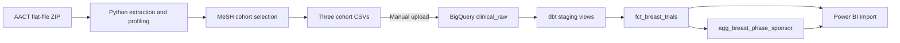

# Breast Neoplasm Clinical Trial Analytics

A snapshot-based data engineering learning project using **Python, BigQuery, dbt, and Power BI**. It builds a defined cohort of breast-neoplasm-related interventional trials from AACT and describes their registered phases, lead sponsor classes, and reported start years.

**Initial version:** local extraction and cohort preparation, manual BigQuery loading, tested dbt transformations, and a Power BI Desktop report. Daily API ingestion, scheduling, and automated loading are planned, not implemented.

## Dashboard


Open [the Power BI report](Dashboard/breast_trials_dashboard.pbix) in Power BI Desktop. It contains imported snapshot data; refreshing requires access to the configured BigQuery project, or reconfiguring the connection to your own project.

- **Total Trials:** 11,211 trials in the complete selected cohort.
- **Phase and Lead Sponsor Class:** trial counts for each phase, split by the class of the lead sponsor.
- **Start Year:** distinct trial counts by reported start year through 2025. Missing years, 2026, and future years are excluded from this chart only; the total card includes the full cohort.

## Questions

1. How many trials meet the cohort definition?
2. How are these trials distributed across registered phases and lead sponsor classes?
3. How are their reported start years distributed?

These are descriptive registry analyses, not estimates of treatment efficacy or trial success. Start year is not registration year, and this trend is not a daily update-activity chart.

## Data and cohort definition

Source: [AACT](https://aact.ctti-clinicaltrials.org/), a relational representation of [ClinicalTrials.gov](https://clinicaltrials.gov/) registry data. The baseline snapshot used for this project is dated **2026-10-11**.

The cohort contains trials that:

- Have the exact MeSH label `Breast Neoplasms` in `browse_conditions.txt`, with `mesh_type` of `mesh-list` or `mesh-ancestor` (including ancestor assignments for narrower terms).
- Have `study_type = INTERVENTIONAL` in `studies.txt`.

No restriction is applied to status, phase, sex, start date, or intervention purpose. This is an operational label-based breast-neoplasm cohort, not a clinically adjudicated malignant breast-cancer treatment cohort. The child exports retain all sponsors and all condition labels for selected trials.

Baseline counts:

- Full `studies.txt`: **606,594** trials.
- Full `sponsors.txt`: **966,593** relationships.
- Full `browse_conditions.txt`: **4,395,602** labels.
- Matching trials before the study-type filter: **14,340**.
- Selected exports: **11,211** study rows, **18,746** sponsor rows, **135,504** condition rows.

Counts may change when using another snapshot. The cohort script creates a fresh summary for each run; [the baseline summary](docs/baseline_cohort_summary.json) records the initial result.

## Data flow



`studies` has one row per trial; `sponsors` and condition labels have multiple rows per trial. The mart joins only the lead sponsor, after checking that each selected trial has exactly one. It does not join every sponsor and condition row into a flat trial table, which would multiply records.

dbt models:

- `stg_breast_studies`: trims fields and safely converts dates and enrollment values; one row per trial.
- `stg_breast_sponsors`: standardizes sponsor relationships and categories.
- `fct_breast_trials`: one row per trial, with its lead sponsor and derived start year.
- `agg_breast_phase_sponsor`: one row per phase and lead sponsor class, with `trial_count`.

`breast_conditions` is loaded as a raw source for cohort traceability and later analysis; this initial dbt mart does not transform it.

## Reproduce the initial version

The commands below are for **Windows Command Prompt / Anaconda Prompt**, run from the repository root. The original environment used Python 3.13.9. Python extraction scripts use only the standard library.

### 1. Create the project environment

```bat
python -m venv .venv
.venv\Scripts\python.exe -m pip install -r requirements.txt
.venv\Scripts\python.exe -m pip check
```

### 2. Download and prepare data

Download an AACT **Flat Text Files** snapshot ZIP from the AACT snapshots page. Raw files and processed CSVs are intentionally excluded from Git.

```bat
.venv\Scripts\python.exe src\extract_aact.py --zip "C:\path\to\aact_snapshot.zip"
.venv\Scripts\python.exe src\profile_aact.py
.venv\Scripts\python.exe src\build_breast_cohort.py
```

Extraction writes the three required tables to `data/raw/aact_snapshot/`. Profiling writes `data/processed/raw_profile.json`. Cohort exports and `cohort_summary.json` are written to `data/processed/breast_cohort/`.

### 3. Create BigQuery datasets and upload CSVs

Use your own GCP project. Create `clinical_raw` and `clinical_analytics` in the **same location** (the baseline uses the EU multi-region).

For each CSV in `data/processed/breast_cohort/`, create a table in `clinical_raw`:

- `breast_studies.csv` → `breast_studies`, schema: `config/studies_schema.json`.
- `breast_sponsors.csv` → `breast_sponsors`, schema: `config/sponsors_schema.json`.
- `breast_conditions.csv` → `breast_conditions`, schema: `config/conditions_schema.json`.

Select **CSV**, a comma delimiter, and **skip 1 header row**. Apply the provided schema rather than automatic type inference: raw columns are strings, with typed conversion handled by dbt. If the console does not show CSV options, ensure you are loading a CSV file rather than creating an empty table. Replace existing tables when reloading the same snapshot; do not append it again.

### 4. Configure authentication and dbt

Install the Google Cloud CLI, then authenticate for local application access:

```bat
gcloud auth application-default login
gcloud auth application-default set-quota-project YOUR_GCP_PROJECT_ID
copy config\profiles.example.yml config\profiles.yml
```

Edit `config/profiles.yml`: replace `YOUR_GCP_PROJECT_ID`, and use the location of your datasets. This local profile is ignored by Git. In `dbt/models/sources.yml`, replace the baseline `database: clinical-trials-learning` with your project ID too. Your account needs permission to query the raw tables, create jobs, and create views/tables in the analytics dataset.

```bat
.venv\Scripts\dbt.exe debug --project-dir dbt --profiles-dir config
.venv\Scripts\dbt.exe build --project-dir dbt --profiles-dir config
```

### 5. Open or rebuild the Power BI report

Use **Get data → Google BigQuery**, authorize the Google account with access to your project, and choose **Import**. Set the Billing Project ID to your project ID.

Load `clinical_analytics.agg_breast_phase_sponsor` and `clinical_analytics.fct_breast_trials`:

- Stacked column: `phase` on X, **SUM** of `trial_count` on Y, `sponsor_class` as legend.
- Card: **SUM** of `trial_count`; baseline total 11,211.
- Line: `start_year` on X, **distinct count** of `nct_id` on Y; filter non-null years ≤ 2025 for the baseline report.

The two imported tables are used independently in this version. Do not assume a slicer on one will filter the other. Updating BigQuery does not automatically update the imported report: refresh Power BI after rebuilding the dbt models. Update the snapshot annotation and complete-year cutoff when using a new snapshot.

## Validation

Python profiling checks missing identifiers, malformed rows, duplicate trial IDs, and child-table orphans. Cohort construction checks study uniqueness and exactly one lead sponsor per trial.

dbt includes **24 data tests** covering:

- Identifier uniqueness, non-null fields, and accepted study types/sponsor roles.
- Sponsor-to-study and mart-to-staging relationships.
- Exactly one lead sponsor per trial.
- Date/enrollment conversion failures.
- Row-count preservation and aggregate total/key consistency.

The baseline staged build passed **15 nodes** (2 models and 13 tests); this is not a count of 15 tests. Later mart and aggregate builds were also completed successfully during the guided project. Run `dbt build` against your own warehouse to validate a reproduction.

## Limitations and next steps

- Single snapshot; manual download/upload and manually invoked dbt. No scheduled pipeline or daily API updates yet.
- Registry dates can be actual or anticipated. Enrollment retains the actual/anticipated type and should not be pooled without considering it.
- `NA` phase is not applicable; `MISSING` represents a missing source value. Sponsor `OTHER` is preserved and is not relabeled as academic.
- Historical registry coverage and reporting delays affect trends; annual counts alone do not establish changes in research investment.
- Power BI Import is a snapshot, not a real-time dashboard.
- Local credentials, the virtual environment, raw datasets, and generated dbt artifacts are excluded from the repository. The `.pbix` contains imported public registry data and the baseline project connection metadata.

Planned improvements: automated BigQuery loading with repeatable replacement, pipeline orchestration, daily API ingestion with trial-level updates and daily activity history, then infrastructure and CI checks.

## Acknowledgements

Inspired by [ClinicalTrialIntelligence / BenchMark](https://github.com/syedshameersarwar/ClinicalTrialIntelligence) and the [DataTalksClub Data Engineering Zoomcamp](https://github.com/DataTalksClub/data-engineering-zoomcamp). This initial version uses a focused MeSH-defined cohort, Python preparation, and Power BI; it does not reproduce the reference project's Spark, Kafka/Flink, or scheduled daily activity pipeline.
