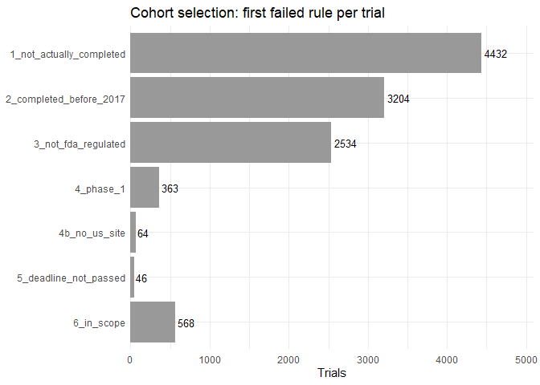
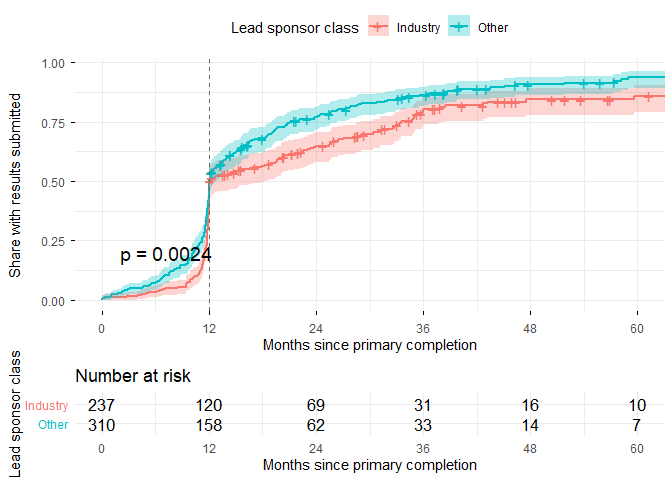

# Timeliness of results submission in breast cancer trials: exploratory pilot


- [0. Setup](#0-setup)
- [1. Cohort funnel](#1-cohort-funnel)
- [2. Sponsor groups](#2-sponsor-groups)
- [3. Deadline scenario](#3-deadline-scenario)
- [4. Common 365-day window](#4-common-365-day-window)
- [5. Time to first results submission (Kaplan–Meier)](#5-time-to-first-results-submission-kaplanmeier)
- [6. Limitations](#6-limitations)

Exploratory, unadjusted analysis of the analytic cohort built by the dbt model `fct_results_reporting`. Input: `data/results_reporting.csv` in the repository root, exported with `02_export_for_r.sql`. Figures are written to `figures/`.

## 0. Setup

``` r
library(dplyr)
library(readr)
library(ggplot2)
library(survival)
library(survminer)

snapshot_date <- as.Date("2026-10-11")   # same as the dbt var snapshot_date
dir.create("figures", showWarnings = FALSE)

trials <- read_csv("../../data/results_reporting.csv", show_col_types = FALSE)

# Conservation check against dbt: 11,211 trials in total, 568 in scope.
nrow(trials)
```

    [1] 11211

``` r
sum(trials$in_scope)
```

    [1] 568

``` r
cohort <- trials |> filter(in_scope)
```

## 1. Cohort funnel

Each excluded trial is counted once, at the first rule it fails. The rules define the analytic cohort; they do not adjudicate legal ACT status.

``` r
funnel <- trials |>
  count(exclusion_reason) |>
  mutate(exclusion_reason = coalesce(exclusion_reason, "6_in_scope")) |>
  arrange(exclusion_reason) |>
  mutate(remaining_before_step = nrow(trials) - lag(cumsum(n), default = 0))
funnel
```

    # A tibble: 7 × 3
      exclusion_reason             n remaining_before_step
      <chr>                    <int>                 <int>
    1 1_not_actually_completed  4432                 11211
    2 2_completed_before_2017   3204                  6779
    3 3_not_fda_regulated       2534                  3575
    4 4_phase_1                  363                  1041
    5 4b_no_us_site               64                   678
    6 5_deadline_not_passed       46                   614
    7 6_in_scope                 568                   568

``` r
ggplot(funnel, aes(x = n, y = reorder(exclusion_reason, desc(exclusion_reason)))) +
  geom_col(fill = "grey60") +
  geom_text(aes(label = n), hjust = -0.15, size = 3.5) +
  scale_x_continuous(expand = expansion(mult = c(0, 0.15))) +
  labs(x = "Trials", y = NULL,
       title = "Cohort selection: first failed rule per trial") +
  theme_minimal()
```



``` r
ggsave("figures/01_funnel.png", width = 7, height = 3.5, dpi = 300)
```

## 2. Sponsor groups

Formal comparisons use the registry lead sponsor classes `INDUSTRY` and `OTHER`. `OTHER` has not been independently classified as academic. The remaining government and network trials (NIH, NETWORK, OTHER_GOV) contribute to cohort totals only.

``` r
cohort <- cohort |>
  mutate(sponsor_group = case_when(
    lead_sponsor_class %in% c("INDUSTRY", "OTHER") ~ lead_sponsor_class,
    TRUE ~ "GOV_NETWORK"
  ))
count(cohort, sponsor_group)
```

    # A tibble: 3 × 2
      sponsor_group     n
      <chr>         <int>
    1 GOV_NETWORK      21
    2 INDUSTRY        237
    3 OTHER           310

``` r
two_groups <- cohort |> filter(sponsor_group %in% c("INDUSTRY", "OTHER"))
```

## 3. Deadline scenario

Scenario deadline: primary completion + 12 calendar months, or + 36 calendar months when `disposition_first_submitted_date` is present. This field is used only as a delay-related indicator (exported as `extension_requested`); the analysis does not establish the legal basis, validity or applicable deadline of each record. The 36-month allowance is an assumption.

Status categories from dbt: `ON_TIME` (submitted by the scenario deadline), `LATE`, `OVERDUE_NOT_REPORTED`, and `EXTENSION_REQUESTED` (unsubmitted, still within the 36-month allowance). The last group is excluded from scenario-based proportions only.

``` r
# All in-scope trials
cohort |> count(reporting_status) |> mutate(share = n / sum(n))
```

    # A tibble: 4 × 3
      reporting_status         n   share
      <chr>                <int>   <dbl>
    1 EXTENSION_REQUESTED      5 0.00880
    2 LATE                   163 0.287  
    3 ON_TIME                312 0.549  
    4 OVERDUE_NOT_REPORTED    88 0.155  

``` r
sum(cohort$reporting_status == "ON_TIME") /
  sum(cohort$reporting_status != "EXTENSION_REQUESTED")
```

    [1] 0.5541741

``` r
# By sponsor group, with exact (Clopper-Pearson) 95% CIs
scenario <- two_groups |>
  filter(reporting_status != "EXTENSION_REQUESTED") |>
  group_by(sponsor_group) |>
  summarise(on_time = sum(reporting_status == "ON_TIME"),
            n = n(),
            .groups = "drop") |>
  mutate(
    share = on_time / n,
    ci_lb = mapply(function(x, n) binom.test(x, n)$conf.int[1], on_time, n),
    ci_ub = mapply(function(x, n) binom.test(x, n)$conf.int[2], on_time, n)
  )
scenario
```

    # A tibble: 2 × 6
      sponsor_group on_time     n share ci_lb ci_ub
      <chr>           <int> <int> <dbl> <dbl> <dbl>
    1 INDUSTRY          141   232 0.608 0.542 0.671
    2 OTHER             160   310 0.516 0.459 0.573

``` r
prop.test(x = scenario$on_time, n = scenario$n)
```


        2-sample test for equality of proportions with continuity correction

    data:  scenario$on_time out of scenario$n
    X-squared = 4.1482, df = 1, p-value = 0.04168
    alternative hypothesis: two.sided
    95 percent confidence interval:
     0.003945128 0.179314049
    sample estimates:
       prop 1    prop 2 
    0.6077586 0.5161290 

``` r
# Frequency of delay-related records by sponsor group
delay_records <- two_groups |>
  group_by(sponsor_group) |>
  summarise(with_record = sum(extension_requested), n = n(),
            share = with_record / n, .groups = "drop")
delay_records
```

    # A tibble: 2 × 4
      sponsor_group with_record     n  share
      <chr>               <int> <int>  <dbl>
    1 INDUSTRY               32   237 0.135 
    2 OTHER                   8   310 0.0258

``` r
prop.test(x = delay_records$with_record, n = delay_records$n)
```


        2-sample test for equality of proportions with continuity correction

    data:  delay_records$with_record out of delay_records$n
    X-squared = 22.053, df = 1, p-value = 2.652e-06
    alternative hypothesis: two.sided
    95 percent confidence interval:
     0.05853935 0.15988994
    sample estimates:
        prop 1     prop 2 
    0.13502110 0.02580645 

## 4. Common 365-day window

The scenario analysis was performed first; this comparison was added afterwards to check whether the sponsor difference depended on the additional time allowed. Neither analysis was pre-specified.

First results submission within 365 days of primary completion, irrespective of delay-related records. Missing submissions count as not meeting this window. This is 365 days, not 12 calendar months. Four trials with a submission date before primary completion are retained and count as within 365 days.

``` r
two_groups <- two_groups |>
  mutate(within_365 = coalesce(
    results_first_submitted_date <= primary_completion_date + 365,
    FALSE
  ))

within_365 <- two_groups |>
  group_by(sponsor_group) |>
  summarise(submitted = sum(within_365), n = n(), share = submitted / n,
            .groups = "drop")
within_365
```

    # A tibble: 2 × 4
      sponsor_group submitted     n share
      <chr>             <int> <int> <dbl>
    1 INDUSTRY            117   237 0.494
    2 OTHER               152   310 0.490

``` r
prop.test(x = within_365$submitted, n = within_365$n)
```


        2-sample test for equality of proportions with continuity correction

    data:  within_365$submitted out of within_365$n
    X-squared = 7.6015e-31, df = 1, p-value = 1
    alternative hypothesis: two.sided
    95 percent confidence interval:
     -0.08454769  0.09124431
    sample estimates:
       prop 1    prop 2 
    0.4936709 0.4903226 

The deadline rule and the denominator both differ between sections 3 and 4, so the comparison cannot isolate the effect of delayed-submission provisions.

## 5. Time to first results submission (Kaplan–Meier)

- Time origin: primary completion date; event: first results submission.
- Unsubmitted trials are censored at the snapshot date.
- Months = days / 30.4375.
- The four trials with a submission date before primary completion get event time 0. These records need review.

``` r
km_data <- two_groups |>
  mutate(
    event = as.integer(!is.na(results_first_submitted_date)),
    end_date = coalesce(results_first_submitted_date, snapshot_date),
    time_days = pmax(as.numeric(end_date - primary_completion_date), 0),
    time_months = time_days / 30.4375
  )

# Censoring times: every in-scope trial has at least 12 months of follow-up.
summary(km_data$time_months[km_data$event == 0])
```

       Min. 1st Qu.  Median    Mean 3rd Qu.    Max. 
      12.16   20.85   34.37   39.13   51.14   99.22 

``` r
km_fit <- survfit(Surv(time_months, event) ~ sponsor_group, data = km_data)

# Log-rank test of the full curves
survdiff(Surv(time_months, event) ~ sponsor_group, data = km_data)
```

    Call:
    survdiff(formula = Surv(time_months, event) ~ sponsor_group, 
        data = km_data)

                             N Observed Expected (O-E)^2/E (O-E)^2/V
    sponsor_group=INDUSTRY 237      185      217      4.76      9.25
    sponsor_group=OTHER    310      271      239      4.33      9.25

     Chisq= 9.3  on 1 degrees of freedom, p= 0.002 

``` r
# Survival S(t) at 12, 24 and 36 months; cumulative submission is 1 - S(t)
summary(km_fit, times = c(12, 24, 36))
```

    Call: survfit(formula = Surv(time_months, event) ~ sponsor_group, data = km_data)

                    sponsor_group=INDUSTRY 
     time n.risk n.event survival std.err lower 95% CI upper 95% CI
       12    120     117    0.506  0.0325        0.447        0.574
       24     69      34    0.350  0.0318        0.293        0.418
       36     31      26    0.201  0.0289        0.152        0.267

                    sponsor_group=OTHER 
     time n.risk n.event survival std.err lower 95% CI upper 95% CI
       12    158     152    0.510  0.0284        0.457        0.568
       24     62      82    0.230  0.0246        0.187        0.284
       36     33      24    0.138  0.0208        0.103        0.186

``` r
# fun = "event" plots cumulative submission, 1 - S(t).
p <- ggsurvplot(
  km_fit, data = km_data,
  fun = "event", conf.int = TRUE, risk.table = TRUE,
  xlim = c(0, 60), break.time.by = 12,
  xlab = "Months since primary completion",
  ylab = "Share with results submitted",
  legend.title = "Lead sponsor class", legend.labs = c("Industry", "Other"),
  pval = TRUE, ggtheme = theme_minimal()
)
# 12-month reference line, not a trial-specific legal deadline
p$plot <- p$plot + geom_vline(xintercept = 12, linetype = "dashed", colour = "grey40")
p
```



``` r
png("figures/02_km_by_sponsor.png", width = 7, height = 6, units = "in", res = 300)
print(p)
invisible(dev.off())
```

## 6. Limitations

- Deadlines and eligibility are operational approximations. Registry missingness (for example empty FDA-regulation flags) may bias selection in an unknown direction.
- Missing phase values are retained.
- Comparisons are unadjusted and ignore clustering by sponsor.
- Kaplan–Meier assumes non-informative censoring. Proportional hazards have not been tested and would need checking before fitting a Cox model.
- Submission does not establish public posting, complete reporting or journal publication.
