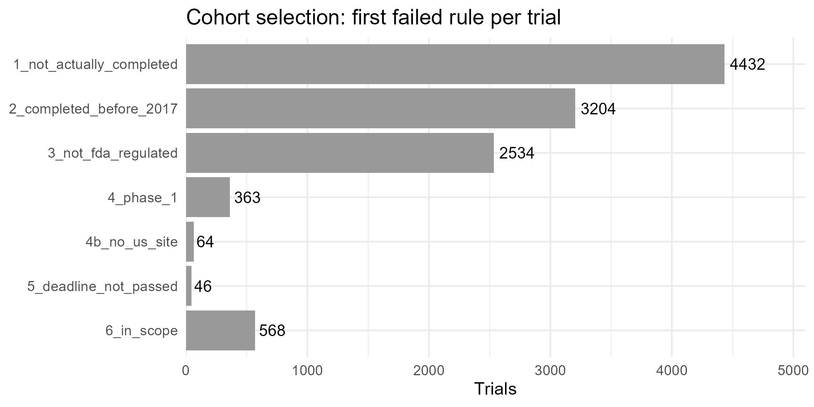
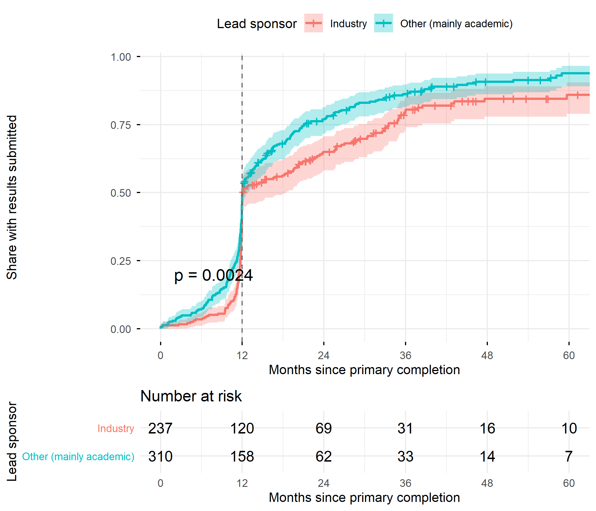

# Timeliness of results reporting in breast cancer trials under FDAAA 801

> **Status: exploratory pilot analysis (November 2026).** The protocol was not
> pre-registered; all results below are preliminary and unadjusted.

## Question

The FDA Amendments Act (FDAAA 801) and its 2017 Final Rule require applicable
clinical trials to submit summary results to ClinicalTrials.gov within 12 months
of primary completion, with a possible delay of up to two further years after a
certification or extension request.

For interventional breast cancer trials:

1. What share of trials that were due to report did so on time?
2. Does timeliness differ between industry and other (mainly academic) lead sponsors?
3. If it does, does the difference come from faster submission or from the use
   of the extension mechanism?

## Data and cohort

- **Source:** AACT snapshot of ClinicalTrials.gov, 2026-10-11. The breast
  neoplasm cohort (11,211 interventional trials, defined by MeSH condition
  terms) is built by the [data pipeline](../../README.md) of this repository.
- **Cohort rules**, applied in this order (each excluded trial is counted at the
  first rule it fails; dbt model
  [`fct_results_reporting`](../../dbt/models/marts/fct_results_reporting.sql)):

| Rule | Trials remaining | Excluded |
|---|---:|---:|
| Interventional breast neoplasm trials | 11,211 | |
| 1. Primary completion date is actual, not anticipated | 6,779 | 4,432 |
| 2. Primary completion on or after 2017-01-18 (Final Rule) | 3,575 | 3,204 |
| 3. FDA-regulated drug or device (registry flag = yes) | 1,041 | 2,534 |
| 4. Not phase 1 / early phase 1 | 678 | 363 |
| 4b. At least one US site | 614 | 64 |
| 5. 12-month deadline passed by the snapshot date | **568** | 46 |

Rules 1–4b approximate the "applicable clinical trial" definition from
registry fields; the registry does not state ACT status directly.

## Outcomes

- **Reporting status** (legal deadline): `ON_TIME` if results were first
  submitted by the due date, `LATE` if submitted after it, `OVERDUE_NOT_REPORTED`
  if not submitted, `EXTENSION_REQUESTED` if not submitted but still within an
  extended deadline. The due date is primary completion + 12 months, or + 36
  months when a certification/extension was submitted (the maximum possible
  delay; a simplification).
- **Strict 12-month timeliness:** results submitted within 365 days of primary
  completion, ignoring extensions.
- **Time to results submission:** months from primary completion to first
  submission, censored at the snapshot date.

Compliance is judged on the submission date, not the public posting date.

## Methods

Proportions with exact (Clopper–Pearson) 95% confidence intervals;
two-proportion tests (χ² with continuity correction); Kaplan–Meier estimates of
the cumulative share with results submitted, compared with the log-rank test.
Small sponsor classes (NIH, network, other government; 21 trials) are pooled and
not compared formally. Analysis code: [`03_compliance_analysis.qmd`](03_compliance_analysis.qmd).

## Results

**Overall (n = 568):** 312 trials (54.9%) reported on time, 163 (28.7%) late,
88 (15.5%) were overdue and had not reported, and 5 (0.9%) were still within an
extension.

**By lead sponsor:**

| | Industry | Other (mainly academic) | Difference |
|---|---:|---:|---|
| Trials | 237 | 310 | |
| On time, legal deadline¹ | 60.8% (141/232; 95% CI 54.2–67.1) | 51.6% (160/310; 95% CI 45.9–57.3) | 9.2 points (95% CI 0.4–17.9), p = 0.04 |
| Extension or certification submitted | 13.5% (32/237) | 2.6% (8/310) | 10.9 points (95% CI 5.9–16.0), p < 0.001 |
| Results within 12 months (strict) | 49.4% (117/237) | 49.0% (152/310) | 0.3 points (95% CI −8.5 to 9.1), p = 1.0 |
| Results within 24 months (Kaplan–Meier) | 65.0% | 77.0% | log-rank p = 0.002 (full curves) |
| Results within 36 months (Kaplan–Meier) | 79.9% | 86.2% | |

¹ Excludes the 5 industry trials still within an extension, whose outcome is not yet known.

## Interpretation

Judged against the legal deadline, industry-sponsored trials appear more
compliant. However, the difference disappears with a strict 12-month definition,
and over the whole follow-up other sponsors submitted results *faster*
(77% vs 65% by 24 months). Industry trials used the extension mechanism about
five times as often. The apparent industry advantage therefore seems to come
mainly from legally delayed reporting rather than from earlier submission.

These are unadjusted associations. Industry and academic trials differ in
phase, size, product type and completion year.

## Limitations

- **Selection through the FDA-regulation flag.** The flag is mostly empty for
  trials completed before about 2020, and the missingness is unlikely to be
  random. Trials that report the flag may also be more diligent reporters, so
  compliance is probably overestimated. For comparison, Curtin et al. (2026)
  found that 27% of applicable antimicrobial trials had reported at one year.
- **ACT status is approximated** from registry fields (rules 1–4b).
- **Extensions** are given the maximum 36-month deadline. Actual deadlines after
  certification depend on approval dates, which the registry does not record.
- **Registry results only.** Journal publications are not searched.
- **Clustering.** Trials from the same sponsor are not independent; the tests
  above ignore this.
- **Non-proportional hazards.** The Kaplan–Meier curves are close at 12 months
  and diverge afterwards, so a single Cox hazard ratio would be misleading.

## Possible next steps

- Sensitivity analysis without the FDA-flag requirement (US sites and product
  type as the ACT proxy), to estimate how much the flag selection inflates compliance.
- Adjusted models (phase, enrollment, completion year, product type) with
  sponsor-level clustering, and methods that do not assume proportional hazards
  (e.g. restricted mean survival time).
- Comparison with publication-based reporting and with the EU Clinical Trials Regulation.

## Reproduce

1. Build the dbt models: `dbt build --select fct_results_reporting agg_results_reporting_by_sponsor`
   (dbt tests include grain, accepted values and a warning for trials whose
   results date precedes primary completion: 23 in the full cohort, 4 in scope).
2. Run [`02_export_for_r.sql`](02_export_for_r.sql) in BigQuery and save the
   result as `data/results_reporting_.csv` in the repository root (git-ignored).
3. Render [`03_compliance_analysis.qmd`](03_compliance_analysis.qmd) with Quarto
   or run it in RStudio from this folder.

[`01_data_audit.sql`](01_data_audit.sql) contains the data-quality checks used
to choose the cohort rules (fill rates, value spellings, FDA-flag missingness by
year, date consistency).

## Reference

Curtin M, Wiltshire A, Nilsonne G, Siebert M. Results reporting in antimicrobial
agent clinical trials: an analysis of compliance and timeliness under the 2017
FDA Amendments Act Final Rule. *J Clin Epidemiol.* 2026;196:112307.
